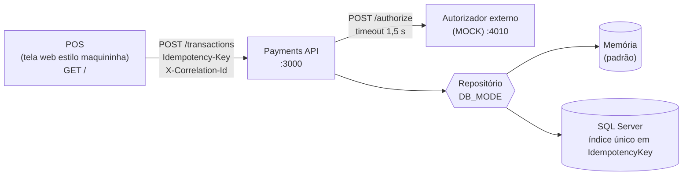

# pos-payments-qa

Projeto de demonstração de **QA para pagamentos em maquininha (POS)**. Uma API de vendas pequena, com um mock do autorizador (bandeira) e uma tela de maquininha, serve de alvo para uma estratégia de testes completa:

- testes de **API** com Playwright (valor limite, partição de equivalência, tabela de decisão, transição de estado, idempotência, mocks)
- testes de **UI mobile** (Pixel 7), incluindo o cenário de **resposta perdida**
- **contrato** consumer-driven com Pact (pronto para PactFlow)
- **smoke** em Robot Framework e **carga** com Locust (com critérios de aceite)
- persistência e validação direta no **SQL Server**
- **CI/CD** no GitHub Actions com um **modo bug** que deixa a pipeline vermelha
- **observabilidade**: logs JSON com correlation ID e consultas/alertas para Splunk e Datadog

> O risco nº 1 em pagamentos é a **cobrança duplicada**. Quase tudo aqui gira em torno de provar que ela não acontece, e de mostrar a suíte pegando o defeito quando ele é introduzido.

## Arquitetura



| Regra do mock (centavos do valor) | Resultado |
|---|---|
| termina em **99** | recusada → `declined` (201) |
| termina em **98** | autorizador demora 3 s → **`pending` (202)**. A API nunca aprova nem recusa sozinha |
| demais | aprovada → `approved` (201) com código de 6 dígitos |

### Endpoints

| Método | Rota | Descrição |
|---|---|---|
| POST | `/transactions` | Cria venda. Header **`Idempotency-Key` obrigatório**. Body `{ amount (centavos), method: credit\|debit\|pix, installments? }` |
| GET | `/transactions/:id` | Consulta (200/404) |
| GET | `/transactions?idempotencyKey=` | Lista por key (prova que não houve duplicidade) |
| POST | `/transactions/:id/cancel` | approved → cancelled (200); já cancelada (409); declined/pending (422) |
| GET | `/health` | `{ status: "ok", dbMode }` |
| POST | `/__test/reset`, `/__test/seed` | Só com `ENABLE_TEST_ROUTES=1` |

Idempotência: mesma key e mesmo body → **mesma transação com 200**, sem chamar o autorizador de novo. Mesma key com body diferente → **409**.

## Como rodar localmente (Windows)

Pré-requisitos: **Node 22+**, **Python 3.11+** (para Robot e Locust) e, opcionalmente, **Docker Desktop** (para SQL Server).

```powershell
# 1. Dependências Node + navegador do Playwright
npm ci
npx playwright install chromium

# 2. Dependências Python (Robot Framework + Locust)
py -3.11 -m venv .venv
.\.venv\Scripts\Activate.ps1
pip install -r robot/requirements.txt

# 3. Subir mock + API (deixe este terminal aberto)
npm run dev
# POS:  http://localhost:3000
# API:  http://localhost:3000/health
```

Os testes Playwright (`test:api`, `test:ui`, `test:bug`, `test:db`) **sobem o mock e a API sozinhos** (webServer). Se `npm run dev` já estiver rodando, eles reaproveitam esses servidores. Para o **modo bug**, pare o `npm run dev` antes.

`test:robot` e `test:perf` **assumem a API já rodando** (`npm run dev` em outro terminal), como fariam contra um ambiente de homologação. Rode-os com o venv do Python ativado.

### SQL Server (opcional, Docker)

```powershell
npm run db:up                         # sobe só o SQL Server (docker compose)
npm run db:init                       # cria banco, tabela e índice único (espera até ~60 s)
$env:DB_MODE="sqlserver"; npm run dev # API usando o SQL Server
npm run test:db                       # API + SELECT direto no banco
```

Ou o ambiente completo (SQL Server + mock + API) com `docker compose up -d --build`.

Variáveis: `DB_HOST` (localhost), `DB_PORT` (1433), `DB_USER` (sa), `DB_PASSWORD` (`PosPayments@2026`, **apenas dev**), `DB_NAME` (PosPayments).

## Scripts

| Script | O que faz |
|---|---|
| `npm run dev` | Sobe mock (4010) + API (3000) com reload |
| `npm start` / `npm run start:mock` | Sobe só a API / só o mock |
| `npm run typecheck` | `tsc --noEmit` |
| `npm test` | Todos os projetos Playwright (api, mobile, db) |
| `npm run test:api` | 40 testes de API |
| `npm run test:smoke` | Só os testes `@smoke` de API |
| `npm run test:ui` | Testes da tela do POS em Pixel 7 |
| `npm run test:bug` | Liga `BUG_MODE=1` e roda os testes `@idempotencia`. **Deve falhar** |
| `npm run test:contract` | Pact: consumer gera `/pacts` e depois o provider verifica |
| `npm run pact:publish` | Publica no PactFlow se `PACT_BROKER_BASE_URL` e `PACT_BROKER_TOKEN` existirem; senão avisa e sai com 0 |
| `npm run test:robot` | Smoke Robot Framework (API rodando) |
| `npm run test:perf` | Locust: 20 usuários, spawn 5, 30 s. Reprova se p95 > 500 ms ou falhas > 1% (API rodando) |
| `npm run db:up` / `npm run db:init` | Sobe o SQL Server / cria o schema |
| `npm run test:db` | Validação direta no SQL Server (`DB_MODE=sqlserver`) |

## Modo bug (demonstração)

Com `BUG_MODE=1` a API **ignora a idempotência**: cada retry vira uma cobrança nova. O código está marcado como proposital em [api/src/routes/transactions.ts](api/src/routes/transactions.ts).

**Local:**

```powershell
npm run test:bug
```

Resultado esperado: os testes `@idempotencia` falham. No POS-087 (resposta perdida), o relatório mostra **2 transações aprovadas** para a mesma `Idempotency-Key`.

Para explorar na tela: `npx cross-env BUG_MODE=1 npm run dev`.

**Na pipeline:** GitHub → *Actions* → *CI - pos-payments-qa* → *Run workflow* → marcar **bug_mode** → *Run*. Os jobs de API, UI e Robot ficam vermelhos. O job **SQL Server fica verde** porque o índice único em `IdempotencyKey` barra a segunda linha. É a segunda camada de defesa funcionando.

## Onde ver os relatórios

| Relatório | Local | CI (artifact) |
|---|---|---|
| Playwright (API/UI/DB) | `npx playwright show-report` (`playwright-report/`) | `playwright-report-api`, `-mobile`, `-sqlserver` |
| Pact | `pacts/pos-terminal-pos-payments-api.json` | `pacts` |
| Robot Framework | `reports/robot/report.html` e `log.html` | `robot-report` |
| Locust | `reports/locust.html` | `locust-report` |

## Estrutura

```
api/src            app, server, rotas, middleware de correlation ID, logger, repositórios (memória | SQL Server)
api/public         tela do POS (HTML/CSS/JS puros)
mocks/authorizer   mock do autorizador
client             cliente TypeScript do POS (consumer do Pact)
tests/api          Playwright: regras de negócio
tests/ui           Playwright: tela do POS em Pixel 7 (+ Page Object em tests/support)
tests/contract     Pact consumer e provider (Vitest)
tests/db           validação direta no SQL Server
features           Gherkin em português com tags @POS-xxx (importáveis no Xray)
robot/tests        smoke Robot Framework
performance        Locust
db/init.sql        schema com índice único de idempotência
docs               estratégia, casos de teste, observabilidade
```

Documentação: [estratégia de testes](docs/estrategia-de-testes.md) · [casos de teste](docs/casos-de-teste.md) · [observabilidade](docs/observabilidade.md)

## Roteiro de demo (15 min)

| Tempo | O que mostrar |
|---|---|
| 0–2 min | **Contexto e riscos.** Diagrama acima e a tabela de riscos em `docs/estrategia-de-testes.md`. Cobrança duplicada é o risco nº 1. |
| 2–4 min | **A maquininha.** `npm run dev`, abrir `http://localhost:3000` no modo responsivo. Vender R$ 25,50 no débito (aprovada), R$ 10,99 (recusada) e R$ 10,98 (pending: "não cobre o cliente novamente"). |
| 4–7 min | **Testes de API.** `npm run test:api`. Mostrar os `describe` com a técnica no nome (valor limite, tabela de decisão, transição de estado) e o mock determinístico pelos centavos. |
| 7–10 min | **O cenário mais importante.** Abrir o POS-087 em `tests/ui/pos-sale.spec.ts` (`route.fetch()` + `route.abort()`). Rodar `npm run test:ui`, depois `npm run test:bug` e mostrar no relatório as **2 transações aprovadas** com a mesma key. |
| 10–12 min | **Contrato.** `npm run test:contract`. Pact gerado em `/pacts`, provider states com `/__test/seed`, `pact:publish` pronto para o PactFlow. |
| 12–14 min | **Pipeline e banco.** `.github/workflows/ci.yml`: jobs encadeados, artifacts, `workflow_dispatch` com bug_mode. O job SQL Server segue verde em modo bug por causa do índice único (defesa em profundidade). |
| 14–15 min | **Produção.** `docs/observabilidade.md`: correlation ID ponta a ponta, alerta de taxa de pending no Datadog/Splunk. Fechar com os próximos passos. |

## Próximos passos

- **Appium + Kotlin em POS Android real**: os casos manuais de hardware (POS-200..205), começando por reinício no meio da venda e troca de rede.
- **PactFlow contínuo**: publicar a verificação do provider, usar `can-i-deploy` como gate antes do deploy e `record-deployment` por ambiente.
- **JMeter** como alternativa ao Locust, se for o padrão do time (mesmos critérios: p95 e taxa de falha).
- **Dashboards no Datadog**: taxa de approved/declined/pending, p95 por rota e monitores de anomalia descritos em `docs/observabilidade.md`.
- **Xray**: importar `features/*.feature` (tags `@POS-xxx`) e enviar os resultados do Playwright (JUnit) e do Robot (`output.xml`) pela API do Xray no CI.
- Testes de segurança da API (autenticação do terminal, rate limiting) e mutation testing nas regras de validação.

## Limitações conhecidas

- **SQL Server não foi executado na máquina onde o projeto foi criado** (sem Docker disponível). `db:init`, o repositório SQL Server e `tests/db` passam no typecheck. O retry do `db:init` e o skip dos testes sem `DB_MODE=sqlserver` foram verificados. A execução real fica para o job `sqlserver-integration` do CI ou para uma máquina com Docker.
- A imagem `mcr.microsoft.com/mssql/server:2022-latest` é **amd64**. Em Mac com Apple Silicon ela roda via emulação (Rosetta no Docker Desktop).
- O Playwright atual não oferece Chromium para **macOS 12**. Nesse caso, rode os testes de UI com o Chrome instalado: `PW_CHANNEL=chrome npm run test:ui`. No Windows e no Ubuntu do CI isso não é necessário.
- Python: o CI usa 3.11. Localmente também foi validado com Python 3.14.
- O repositório em memória é por processo: reiniciar a API apaga as vendas. Use `DB_MODE=sqlserver` para persistir.
