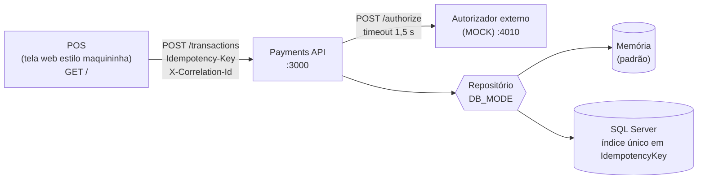

# pos-payments-qa

[](https://github.com/MaxQasouza/pos-payments-qa/actions/workflows/ci.yml)

Estratégia de QA para **pagamentos em maquininha (POS)**. O alvo dos testes é uma API de vendas pequena, com um mock do autorizador (bandeira) e uma tela de maquininha. Os testes cobrem várias camadas:

- testes de **API** com Playwright (valor limite, partição de equivalência, tabela de decisão, transição de estado, idempotência, falhas do autorizador)
- testes de **UI mobile** (Pixel 7), incluindo o cenário de **resposta perdida**
- **contrato** consumer-driven com Pact, pronto para PactFlow
- **smoke** em Robot Framework e **carga** com Locust, ambos com critério de aceite
- validação direta da persistência no **SQL Server**
- **CI/CD** no GitHub Actions, com um **modo bug** que injeta o defeito e prova que a pipeline o detecta
- **observabilidade**: logs JSON com correlation ID e consultas e alertas para Splunk e Datadog
- uma **collection do Postman** com os mesmos cenários de API, para exploração manual

> Em pagamentos, o defeito mais caro não é uma tela quebrada. É **cobrar o cliente duas vezes**. A estratégia parte dos riscos do negócio. Quase tudo aqui existe para provar que a cobrança duplicada não acontece, e que a suíte pega o defeito quando ele é introduzido.

---

## Avaliação rápida (5 minutos)

```powershell
npm ci
npx playwright install chromium
npm test                 # 48 testes de API + UI mobile. Sobe mock e API sozinho
npm run test:contract    # Pact: consumer gera o contrato e o provider verifica
npm run test:bug         # injeta o defeito de idempotência. DEVE FALHAR
npx playwright show-report
```

Arquivos que concentram as decisões mais importantes:

| Arquivo | O que observar |
|---|---|
| [docs/estrategia-de-testes.md](docs/estrategia-de-testes.md) | Riscos priorizados, pirâmide, técnicas, transição de estados, tabela de decisão e o que fica fora do escopo |
| [api/src/routes/transactions.ts](api/src/routes/transactions.ts) | Idempotência (hash do body, replay com 200, conflito com 409). A transação nasce `pending` antes de chamar a bandeira |
| [tests/ui/pos-sale.spec.ts](tests/ui/pos-sale.spec.ts) | **POS-087, resposta perdida**: `route.fetch()` deixa a bandeira aprovar e `route.abort()` corta a resposta antes do POS. O retry reusa a mesma key e o teste prova que existe **uma única** transação |
| [tests/api/transactions.spec.ts](tests/api/transactions.spec.ts) | Testes organizados por técnica, com IDs `POS-xxx` rastreáveis até os casos e o Gherkin |
| [db/init.sql](db/init.sql) | Índice único em `IdempotencyKey`, a segunda camada de defesa |
| [.github/workflows/ci.yml](.github/workflows/ci.yml) | 7 jobs encadeados, artifacts e `workflow_dispatch` com `bug_mode` |
| [docs/observabilidade.md](docs/observabilidade.md) | Formato do log, correlation ID ponta a ponta e consultas e alertas em Splunk e Datadog |

## Resultado da execução

| Camada | Ferramenta | Testes | Resultado |
|---|---|---|---|
| API | Playwright | 40 | ✅ 40 passaram |
| UI mobile (Pixel 7) | Playwright | 8 | ✅ 8 passaram |
| Contrato | Pact (Vitest) | consumer e provider | ✅ verificado |
| Smoke | Robot Framework | 5 | ✅ 5 passaram |
| Carga | Locust (20 usuários, 30 s) | p95 < 500 ms e falhas < 1% | ✅ p95 ≈ 13 ms, 0% de falhas |
| Persistência | Playwright + SQL Server | 3 | ✅ no job `sqlserver-integration` do CI |
| Exploratório | Postman / Newman | 43 requisições | ✅ 91 asserções |
| **Modo bug** | API + UI `@idempotencia` | 5 | ❌ falham, como esperado (ver abaixo) |

`retries: 0` de propósito: em pagamento, um teste instável mascarado pelo retry pode esconder um bug real.

---

## Arquitetura



O mock do autorizador é **determinístico**: os centavos do valor decidem o resultado. Assim, nenhum teste depende de sorte.

| Centavos do valor | Resultado |
|---|---|
| terminam em **99** | recusada: `declined` (201) |
| terminam em **98** | o autorizador demora 3 s e a venda fica **`pending` (202)**. A API nunca aprova nem recusa sozinha |
| demais | aprovada: `approved` (201), com código de autorização de 6 dígitos |

### Endpoints

| Método | Rota | Descrição |
|---|---|---|
| POST | `/transactions` | Cria uma venda. O header **`Idempotency-Key` é obrigatório**. Body: `{ amount (centavos), method: credit\|debit\|pix, installments? }` |
| GET | `/transactions/:id` | Consulta uma venda (200 ou 404) |
| GET | `/transactions?idempotencyKey=` | Lista as vendas de uma key. Prova que não houve duplicidade |
| POST | `/transactions/:id/cancel` | `approved` → `cancelled` (200). Já cancelada: 409. `declined` ou `pending`: 422 |
| GET | `/health` | `{ status: "ok", dbMode }` |
| POST | `/__test/reset`, `/__test/seed` | Só existem com `ENABLE_TEST_ROUTES=1`. Usadas pelos provider states do Pact |

**Idempotência:**
- sem `Idempotency-Key`: **400**;
- mesma key e mesmo body: **a mesma transação com 200**, sem chamar o autorizador de novo;
- mesma key com body diferente: **409**. O body é comparado por hash SHA-256.

**Regras de negócio violadas** (valor ou parcelas) respondem **422**, e não 400. O 400 fica reservado para requisição malformada.

**Duas camadas de defesa contra cobrança duplicada:**
1. A aplicação procura a key antes de processar.
2. O índice único no banco recusa a segunda linha quando duas requisições chegam ao mesmo tempo.

---

## Como rodar localmente

Pré-requisitos:
- **Node 22+**;
- **Python 3.11+**, para Robot e Locust;
- opcionalmente, **Docker**, para o SQL Server.

```powershell
# 1. Dependências Node e navegador do Playwright
npm ci
npx playwright install chromium

# 2. Dependências Python (Robot Framework e Locust)
py -3.11 -m venv .venv
.\.venv\Scripts\Activate.ps1
pip install -r robot/requirements.txt

# 3. Subir o mock e a API (deixe este terminal aberto)
npm run dev
# POS:  http://localhost:3000
# API:  http://localhost:3000/health
```

Os testes do Playwright (`test:api`, `test:ui`, `test:bug`, `test:db`) **sobem o mock e a API sozinhos** pelo `webServer`. Se `npm run dev` já estiver rodando, eles reaproveitam esses servidores. Para o modo bug, pare o `npm run dev` antes.

`test:robot` e `test:perf` **esperam a API já rodando** em outro terminal, como aconteceria contra um ambiente de homologação. Rode-os com o venv do Python ativado.

### SQL Server (opcional, via Docker)

```powershell
npm run db:up                         # sobe só o SQL Server (docker compose)
npm run db:init                       # cria o banco, a tabela e o índice único (espera até ~60 s)
$env:DB_MODE="sqlserver"; npm run dev # API usando o SQL Server
npm run test:db                       # chama a API e confere com SELECT direto no banco
```

Para subir o ambiente completo (SQL Server, mock e API): `docker compose up -d --build`.

Variáveis de ambiente:

| Variável | Padrão |
|---|---|
| `DB_HOST` | `localhost` |
| `DB_PORT` | `1433` |
| `DB_USER` | `sa` |
| `DB_PASSWORD` | `PosPayments@2026` (**apenas para desenvolvimento**) |
| `DB_NAME` | `PosPayments` |

## Scripts

| Script | O que faz |
|---|---|
| `npm run dev` | Sobe o mock (4010) e a API (3000) com reload |
| `npm start` / `npm run start:mock` | Sobe só a API / só o mock |
| `npm run typecheck` | `tsc --noEmit` |
| `npm test` | Todos os projetos do Playwright (api, mobile, db) |
| `npm run test:api` | Os 40 testes de API |
| `npm run test:smoke` | Só os testes de API marcados com `@smoke` |
| `npm run test:ui` | Testes da tela do POS em Pixel 7 |
| `npm run test:bug` | Liga `BUG_MODE=1` e roda os testes `@idempotencia`. **Deve falhar** |
| `npm run test:contract` | Pact: o consumer gera `/pacts` e depois o provider verifica |
| `npm run pact:publish` | Publica no PactFlow se `PACT_BROKER_BASE_URL` e `PACT_BROKER_TOKEN` existirem. Senão, avisa e sai com 0 |
| `npm run test:robot` | Smoke em Robot Framework (com a API rodando) |
| `npm run test:perf` | Locust com 20 usuários, spawn 5, por 30 s. Reprova se o p95 passar de 500 ms ou as falhas passarem de 1% (com a API rodando) |
| `npm run db:up` / `npm run db:init` | Sobe o SQL Server / cria o schema |
| `npm run test:db` | Validação direta no SQL Server (`DB_MODE=sqlserver`) |

## Modo bug: prova de que a suíte detecta o defeito

Uma suíte que nunca falhou não prova nada. Com `BUG_MODE=1`, a API **ignora a verificação de idempotência**, e cada retry vira uma cobrança nova. O desvio está isolado e marcado como proposital em [api/src/routes/transactions.ts](api/src/routes/transactions.ts).

```powershell
npm run test:bug
```

Resultado esperado: 5 testes `@idempotencia` falham (POS-040, 041, 042, 052 e 087). No POS-087 (resposta perdida), o relatório mostra **2 transações aprovadas** para a mesma `Idempotency-Key`, ou seja, o cliente pagou duas vezes.

Para ver na tela: `npx cross-env BUG_MODE=1 npm run dev`.

**Na pipeline:** em *Actions*, abra *CI - pos-payments-qa*, clique em *Run workflow*, marque **bug_mode** e rode.
- Os jobs de API, UI e Robot ficam **vermelhos**.
- O job **SQL Server fica verde**, porque o índice único em `IdempotencyKey` barra a segunda linha. É a segunda camada de defesa funcionando.

## Collection do Postman

[postman/pos-payments-api.postman_collection.json](postman/pos-payments-api.postman_collection.json) espelha os testes de API, com os mesmos IDs `POS-xxx`. São 43 requisições com asserções, organizadas em pastas: fluxo principal, valor limite, partição, tabela de decisão, idempotência, autorizador e cancelamento.

- **No Postman:** importe o arquivo e rode a collection inteira pelo **Collection Runner**, na ordem. Para chamar `localhost`, use o Postman Desktop.
- **Pela linha de comando**, com a API rodando:

```powershell
npx -y newman@6.2.1 run postman/pos-payments-api.postman_collection.json
```

Com a API em modo bug, a pasta **05 Idempotência** fica vermelha.

## Pipeline (GitHub Actions)

```
quality (typecheck)
   └── api-tests ──┬── contract-tests (Pact)
                   ├── ui-mobile-tests (Pixel 7)
                   ├── robot-smoke
                   ├── performance (Locust)
                   └── sqlserver-integration (service container SQL Server 2022)
```

Cada job publica o seu relatório como artifact. Em modo bug, Robot, Locust e SQL Server rodam mesmo com a API vermelha, para que o resultado de cada camada fique visível.

## Onde ver os relatórios

| Relatório | Local | Artifact no CI |
|---|---|---|
| Playwright (API, UI e DB) | `npx playwright show-report` (`playwright-report/`) | `playwright-report-api`, `-mobile`, `-sqlserver` |
| Pact | `pacts/pos-terminal-pos-payments-api.json` | `pacts` |
| Robot Framework | `reports/robot/report.html` e `log.html` | `robot-report` |
| Locust | `reports/locust.html` | `locust-report` |

## Estrutura

```
api/src            app, server, rotas, middleware de correlation ID, logger e repositórios (memória | SQL Server)
api/public         tela do POS (HTML, CSS e JS puros)
mocks/authorizer   mock determinístico do autorizador
client             cliente TypeScript do POS (consumer do Pact)
tests/api          Playwright: regras de negócio
tests/ui           Playwright: tela do POS em Pixel 7 (Page Object em tests/support)
tests/contract     Pact consumer e provider (Vitest)
tests/db           validação direta no SQL Server
features           Gherkin em português com tags @POS-xxx (importáveis no Xray)
robot/tests        smoke em Robot Framework
performance        Locust
postman            collection com os testes de API
db/init.sql        schema com o índice único de idempotência
docs               estratégia, casos de teste e observabilidade
```

Documentação: [estratégia de testes](docs/estrategia-de-testes.md) · [casos de teste](docs/casos-de-teste.md) · [observabilidade](docs/observabilidade.md)

## Decisões de teste

- **A transação nasce `pending` antes de chamar a bandeira.** Nunca existe uma venda que a bandeira aprovou e o sistema não conhece. Um timeout mantém a venda `pending` (202), e não a converte em recusa.
- **A Idempotency-Key é gerada pelo cliente**, porque só o POS sabe que dois envios são a mesma venda. A tela gera uma key por venda e a reusa no "Tentar novamente".
- **Contrato em vez de mais testes ponta a ponta.** O E2E entre serviços é lento e frágil. O contrato quebra no pull request de quem mudou a API, e o `can-i-deploy` do PactFlow pode virar gate de deploy.
- **A UI só testa o que depende da tela.** As regras de negócio ficam na API, a base da pirâmide.
- **Hardware fica com teste manual** (POS-200 a 205): bateria, impressora, troca de chip, reinício no meio da venda, chip contra aproximação e tarja danificada. Simular isso numa tela web não teria valor.
- **Logs sem dado sensível.** Número de cartão, CVV, token e o corpo da requisição nunca são registrados.

## Limitações conhecidas

- O repositório em memória é por processo: reiniciar a API apaga as vendas. Use `DB_MODE=sqlserver` para persistir.
- A conciliação das vendas `pending` está fora do escopo. O retry não duplica a venda e existe um alerta de taxa de pending, mas o próximo passo seria um job de reconciliação com a bandeira.
- Não há autenticação do terminal nem rate limiting.
- A imagem `mcr.microsoft.com/mssql/server:2022-latest` é **amd64**. Em Mac com Apple Silicon, ela roda por emulação.
- O Playwright atual não oferece Chromium para o **macOS 12**. Nesse caso, use o Chrome instalado: `PW_CHANNEL=chrome npm run test:ui`.

## Próximos passos

- **Appium com Kotlin num POS Android real**, para os casos manuais de hardware, começando por reinício no meio da venda e troca de rede.
- **PactFlow contínuo**: publicar a verificação do provider, usar `can-i-deploy` como gate e `record-deployment` por ambiente.
- **Dashboards no Datadog**: taxas de approved, declined e pending, p95 por rota e monitores de anomalia.
- **Xray**: importar `features/*.feature` e enviar os resultados do Playwright (JUnit) e do Robot (`output.xml`) no CI.
- **Job de reconciliação** para vendas `pending`.
- Testes de segurança (autenticação do terminal, rate limiting) e mutation testing nas regras de validação.
