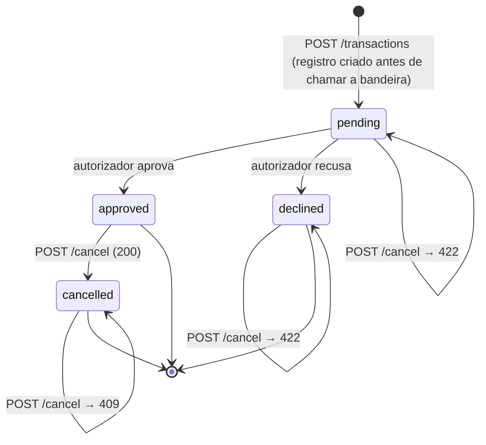

# Estratégia de testes — pos-payments-qa

## 1. Contexto

A maquininha (POS) envia vendas para a **Payments API**, que consulta o **autorizador externo** (bandeira/adquirente) e devolve o resultado. Em pagamentos, o defeito mais caro não costuma ser a tela quebrada. É o dinheiro do cliente cobrado errado. Por isso a estratégia parte dos **riscos de negócio**, não da cobertura de código.

```
POS (tela web) ──HTTP──► Payments API ──HTTP──► Autorizador (mock)
                              │
                              └──► Repositório (memória | SQL Server)
```

## 2. Riscos priorizados

| # | Risco | Impacto | Como é mitigado | Testes |
|---|---|---|---|---|
| 1 | **Cobrança duplicada**: a maquininha reenvia a venda (retry, resposta perdida) e o cliente paga duas vezes | Prejuízo financeiro direto, chargeback, reclamação no Procon/BC | `Idempotency-Key` obrigatória. A aplicação devolve a mesma transação (1ª camada) e o índice único no SQL Server barra a 2ª linha (2ª camada) | POS-040/041/042/052, **POS-087**, POS-090, POS-092, POS-103 |
| 2 | **Status divergente entre POS e backend**: o POS mostra "erro", mas a venda foi aprovada | Lojista cobra de novo ou entrega sem receber | O POS reutiliza a key no "Tentar novamente" e recebe o status real. Testes de contrato garantem que POS e API falam o mesmo formato | POS-086, POS-087, POS-110..113 |
| 3 | **Venda presa em pending**: a bandeira demora e a venda fica sem desfecho | Cliente sem saber se pagou, risco de cobrança dupla manual | Timeout de 1,5 s gera `pending` (a API nunca aprova nem recusa sozinha). O POS orienta "não cobre de novo". Alerta de taxa de pending (ver observabilidade) | POS-051, POS-073, POS-085 |
| 4 | **Validação de valor e parcelas**: valor zero/negativo/decimal, parcelamento no débito/pix | Venda com valor errado, regra comercial violada | Validação na API (422) e CHECK constraints no banco | POS-010..036 |

## 3. Pirâmide de testes deste projeto

```
                ▲  Manual de hardware (POS-200..205): bateria, impressora, chip, NFC
               ▲▲▲  UI mobile Playwright (8): fluxos críticos + resposta perdida
             ▲▲▲▲▲  Contrato Pact (4) · Robot smoke (5) · SQL Server (3) · Locust (1)
         ▲▲▲▲▲▲▲▲▲  API Playwright (40): regras, limites, estados, idempotência, mocks
```

- **Base larga em API**: rápida (~10 s), determinística (mock controlado pelo valor) e cobre as regras de negócio.
- **Contrato** no lugar de E2E entre times: o POS (consumer) declara o que usa e a API (provider) prova que atende, sem precisar subir todo o ecossistema.
- **UI só onde a tela importa**: comprovante, mensagens de pending/erro e o cenário de resposta perdida, que depende do comportamento do front (reusar a key).
- **Manual** para o que depende de hardware real.

### Técnicas de teste aplicadas

| Técnica | Onde |
|---|---|
| Análise de valor limite | amount 0/1/10.000.000/10.000.001; parcelas 0/1/12/13 |
| Partição de equivalência | amount string/decimal/negativo/ausente; method inválido |
| Tabela de decisão | method × installments |
| Transição de estado | approved → cancelled; cancelled/declined/pending → cancelar |
| Injeção de falha (mock) | recusa (…99), timeout (…98), offline, resposta abortada |
| Contrato orientado ao consumer | Pact pos-terminal → pos-payments-api |

## 4. Transição de estados da transação



> A transação nasce `pending` **antes** de chamar o autorizador. Se a API cair no meio, existe registro para conciliação: nunca há venda "invisível".

## 5. Tabela de decisão: method × installments

| Regra | method | installments | Resultado | Caso |
|---|---|---|---|---|
| R1 | credit | omitido | 201, installments = 1 | POS-030 |
| R2 | credit | 1 a 12 | 201 | POS-015, POS-016, POS-031 |
| R3 | credit | < 1 ou > 12 | 422 INVALID_INSTALLMENTS | POS-014, POS-017 |
| R4 | debit | omitido ou 1 | 201, installments = 1 | POS-032, POS-033 |
| R5 | debit | ≠ 1 | 422 INVALID_INSTALLMENTS | POS-034 |
| R6 | pix | omitido ou 1 | 201, installments = 1 | POS-035 |
| R7 | pix | ≠ 1 | 422 INVALID_INSTALLMENTS | POS-036 |
| R8 | outro | qualquer | 422 INVALID_METHOD | POS-024 |

## 6. Mocks e dados de teste

O mock do autorizador é **determinístico pelos centavos** do valor. Assim o mesmo teste dá sempre o mesmo resultado, sem estado compartilhado:

| Centavos | Resposta do mock | Resultado na API |
|---|---|---|
| …99 | `approved: false, reason: CARTAO_RECUSADO` | declined (201) |
| …98 | aprova, mas só depois de 3 s | pending (202) por timeout de 1,5 s |
| demais | `approved: true` + código de 6 dígitos | approved (201) |

Cada teste gera a própria `Idempotency-Key` (UUID), então os testes rodam **em paralelo** sem interferência. `/__test/reset` e `/__test/seed` existem só com `ENABLE_TEST_ROUTES=1` e são usados pelos provider states do Pact.

## 7. O que entra em cada etapa da pipeline

| Etapa (job) | Gatilho | O que valida | Bloqueia merge? |
|---|---|---|---|
| quality | todo push/PR | `tsc --noEmit` | Sim |
| api-tests | após quality | 40 testes de regra de negócio | Sim |
| contract-tests | após quality | consumer gera o pact, provider verifica; publica no PactFlow se houver secrets | Sim |
| ui-mobile-tests | após quality | fluxos da tela em Pixel 7, incluindo resposta perdida | Sim |
| robot-smoke | após api-tests | smoke com a API "de verdade" rodando (como num ambiente) | Sim |
| performance | após api-tests | 20 usuários por 30 s; reprova se p95 > 500 ms ou falhas > 1% | Sim (SLO da demo) |
| sqlserver-integration | após api-tests | API com SQL Server real + validação direta por SELECT | Sim |

**Modo bug** (`workflow_dispatch` com `bug_mode = true`): liga `BUG_MODE=1` e a API passa a ignorar a idempotência. Os jobs de API, UI e Robot ficam vermelhos, mostrando que a suíte pega a cobrança duplicada. O job SQL Server fica **verde** mesmo em modo bug, porque o índice único barra a duplicidade (a 2ª camada de defesa funcionando).

## 8. Fora de escopo (e por quê)

- Criptografia de cartão/PCI, EMV e comunicação real com a bandeira: dependem de hardware e certificação.
- Conciliação/liquidação financeira: outro sistema. Aqui apenas garantimos que `pending` fica rastreável.
- Segurança (autenticação do terminal, rate limiting): evolução natural, fora do objetivo da demo.
