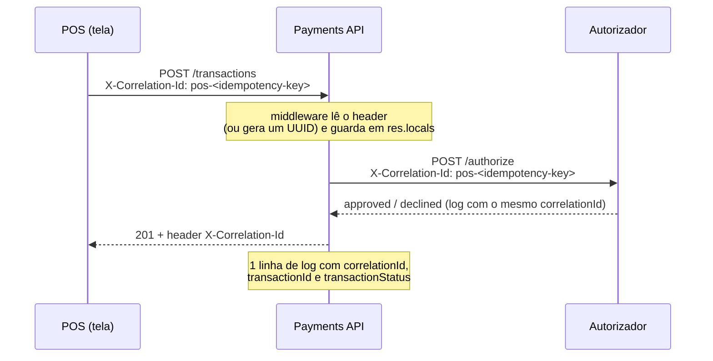

# Observabilidade — pos-payments-qa

Objetivo: responder rápido, em produção, a três perguntas:

1. **Esta venda específica** (que o lojista está reclamando) passou por onde e terminou como?
2. **A taxa de pending/recusa** está fora do normal agora?
3. **A API está lenta** para a maquininha?

## 1. Formato do log

Uma linha JSON por requisição, em `stdout` (pronta para o forwarder do Splunk ou o agent do Datadog):

```json
{
  "timestamp": "2026-11-17T21:19:00.463Z",
  "level": "info",
  "service": "pos-payments-api",
  "correlationId": "pos-3f0c9b2e-7d1a-4c55-9a51-0e8f3c2b7a10",
  "method": "POST",
  "path": "/transactions",
  "statusCode": 201,
  "durationMs": 151.92,
  "transactionId": "36e1ce11-45a0-459b-923b-6a1711a00422",
  "transactionStatus": "approved"
}
```

| Campo | Uso |
|---|---|
| `timestamp` | ISO 8601 em UTC |
| `level` | `info` (2xx/3xx), `warn` (4xx), `error` (5xx) |
| `service` | `pos-payments-api` ou `authorizer-mock` (facet/índice) |
| `correlationId` | rastreia uma venda de ponta a ponta |
| `method`, `path`, `statusCode` | tráfego e erros por rota |
| `durationMs` | latência (p95/p99) |
| `transactionId`, `transactionStatus` | negócio: approved, declined, pending, cancelled |

**O que nunca é logado:** corpo da requisição, número do cartão (PAN), CVV, trilha, token, dados do portador. O logger recebe apenas campos explícitos (não faz dump de `req.body`) e esse é o ponto que se revisa em code review.

## 2. Como o correlation ID liga POS → API → autorizador



- O POS envia `X-Correlation-Id: pos-<idempotency-key>`. Como a key se repete no retry, **todas as tentativas da mesma venda** ficam com o mesmo correlation ID.
- A API devolve o header na resposta (testado em POS-060/061) e repassa ao autorizador, que loga o mesmo valor.
- Com um único ID, o suporte encontra todas as linhas da venda nos dois serviços.

## 3. Splunk

Rastrear uma venda reclamada pelo lojista:

```spl
index=pos correlationId="pos-3f0c9b2e-7d1a-4c55-9a51-0e8f3c2b7a10"
| table _time service method path statusCode transactionStatus durationMs
| sort _time
```

Volume de vendas pending ao longo do tempo:

```spl
index=pos service=pos-payments-api transactionStatus=pending
| timechart span=5m count
```

**Taxa de pending** (base para alerta):

```spl
index=pos service=pos-payments-api method=POST path="/transactions"
| timechart span=5m count(eval(transactionStatus="pending")) AS pending count AS total
| eval pending_rate = round(pending / total * 100, 2)
```

Alerta (*Saved Search* a cada 5 min, disparar se resultado > 0):

```spl
index=pos service=pos-payments-api method=POST path="/transactions" earliest=-10m
| stats count(eval(transactionStatus="pending")) AS pending count AS total
| eval pending_rate = pending / total * 100
| where total >= 50 AND pending_rate > 2
```

Retentativas suspeitas (mesma venda com várias chamadas, sinal de rede ruim no lojista):

```spl
index=pos service=pos-payments-api path="/transactions" method=POST
| stats count AS tentativas dc(transactionId) AS transacoes BY correlationId
| where tentativas > 1
| eval duplicidade = if(transacoes > 1, "SIM - INVESTIGAR", "não")
```

> `transacoes > 1` para o mesmo `correlationId` é exatamente o sintoma do **modo bug**: cobrança duplicada.

Latência p95 por rota:

```spl
index=pos service=pos-payments-api
| timechart span=5m perc95(durationMs) BY path
```

## 4. Datadog

Consultas no Log Explorer:

```
service:pos-payments-api @transactionStatus:declined
service:pos-payments-api @transactionStatus:pending
service:pos-payments-api @correlationId:"pos-3f0c9b2e-7d1a-4c55-9a51-0e8f3c2b7a10"
service:pos-payments-api status:error
service:pos-payments-api @path:"/transactions" @durationMs:>500
```

Para virar métrica, criar *log-based metrics*:

- `pos.transactions.count` (count), agrupado por `@transactionStatus` e `@method`, filtro `service:pos-payments-api @path:"/transactions" @method:POST`
- `pos.request.duration` (distribution) a partir de `@durationMs`

**Monitor: taxa de pending acima do normal**

```
sum(last_10m):
  sum:pos.transactions.count{transactionstatus:pending}.as_count()
  / sum:pos.transactions.count{*}.as_count() * 100 > 2
```

- Warning em 1%, Critical em 2% (ajustar à linha de base real).
- Alternativa: **Anomaly monitor** (`anomalies(..., 'agile', 2)`) para respeitar a sazonalidade (picos de almoço, fim de semana).
- Mensagem: "Taxa de vendas pending em {{value}}%. Verificar latência do autorizador e o dashboard POS. Lojistas podem estar cobrando de novo."

**Monitor: taxa de recusa**: mesmo formato com `transactionstatus:declined`, threshold maior (recusa tem linha de base natural). Um salto súbito costuma indicar problema na bandeira, não nos clientes.

**Monitor: latência**: `p95:pos.request.duration{path:/transactions} > 500` por 5 min (mesmo SLO usado no Locust).

## 5. Ligação com os testes

| Garantia | Teste |
|---|---|
| Correlation ID devolvido/gerado | POS-060, POS-061 |
| Status pending em timeout (gera o sinal do alerta) | POS-051 |
| SLO de latência p95 ≤ 500 ms | POS-120 (Locust) |
